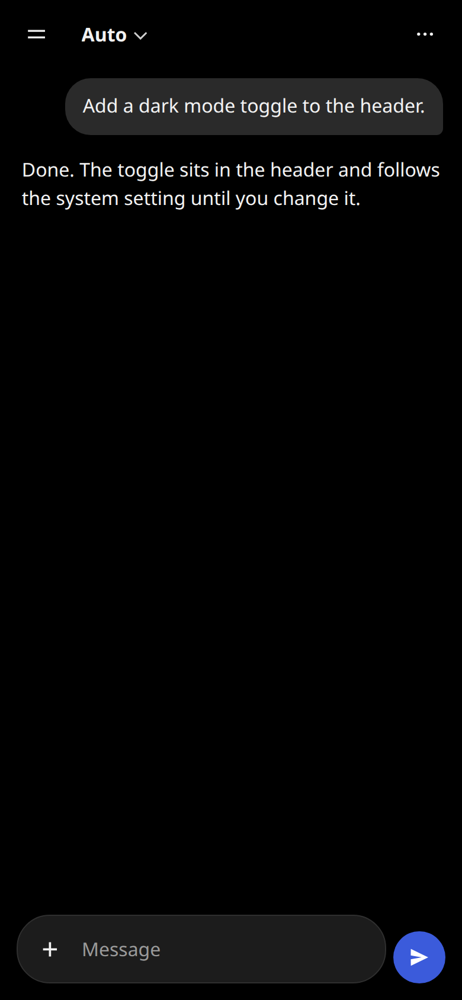
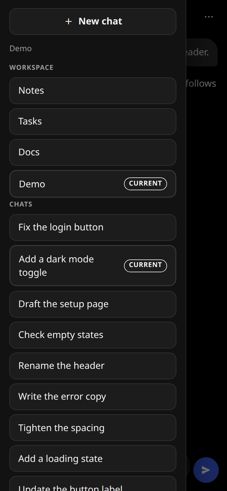
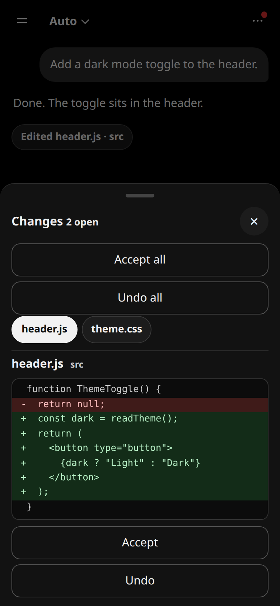
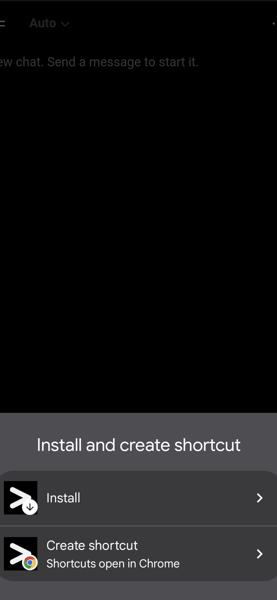

# Cursor Remote

Use a Cursor agent on your PC from your phone or another computer. Only your Tailscale login can open the page.

  
  
  
  

- Chat with the agent.
- Switch workspaces.
- Continue a chat from the phone to Cursor on the PC, and the other way around.
- Accept or undo file changes.
- Install the page on your phone.

Setup: [docs/setup.md](docs/setup.md).
